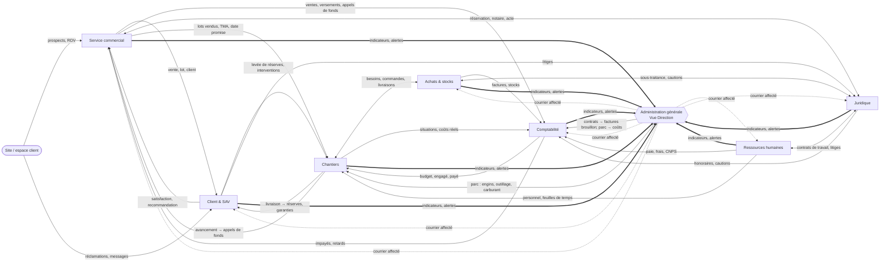

# Liaisons entre les services de l'ERP SIIPAF

> Analyse du 22 octobre 2026, à partir du schéma fléché du client (écran « Modules ») et du code en place (`server/src/services`).
> Elle sert de référence pour le **partage de données**, d'**informations** et de **notifications** entre les 8 modules.
> Légende des états : **✅ existe** dans le code · **🟡 partiel** · **⬜ à faire** · **➕ ajouté** (absent du schéma, proposé ici).

---

## 1. Lecture du schéma du client

Flèches relevées (sens = qui fournit → qui reçoit) :

| # | Liaison dessinée | Lecture |
|---|---|---|
| 1 | Client & SAV → Service commercial | le client livré revient au commercial (satisfaction, recommandation, revente) |
| 2 | Service commercial → Client & SAV | la vente crée le client SAV (lot, programme, date de livraison) |
| 3 | Service commercial → Comptabilité | ventes, versements, appels de fonds |
| 4 | Service commercial → Administration générale | tableau de bord Direction |
| 5 | Client & SAV → Administration générale | tableau de bord Direction |
| 6 | Comptabilité → Chantiers | budget, coûts engagés et payés par chantier |
| 7 | Comptabilité → Achats & stocks | factures, règlements fournisseurs |
| 8 | Comptabilité → Administration générale | trésorerie, marges, Direction |
| 9 | Ressources humaines → Administration générale | effectifs, masse salariale, alertes RH |
| 10 | Ressources humaines ↔ Juridique | contrats de travail, litiges, conformité |
| 11 | Chantiers ↔ Achats & stocks | besoins, commandes, livraisons dépôt ↔ chantier |
| 12 | Chantiers → Comptabilité | situations de travaux, coûts réels |
| 13 | Achats & stocks → Comptabilité | factures d'achat, stocks |
| 14 | Juridique → Comptabilité | actes, cautions, honoraires notaires |
| 15 | Juridique → Administration générale | échéances, contentieux, Direction |

**Constat** : toutes les flèches convergent vers l'**Administration générale** (Vue Direction), ce qui est juste : c'est le module de pilotage. Mais plusieurs liaisons **déjà présentes dans le code** ou **indispensables au métier de promoteur** ne sont pas dessinées (§3).

---

## 2. Ce qui existe déjà dans le code

| Liaison | Mécanisme actuel | État |
|---|---|---|
| Commercial → Comptabilité | `compta.syncAutoEntries` lit `sales`, `payments`, `fund_calls` et génère les écritures | ✅ |
| Commercial → Client (espace client) | `vefa.js` émet les appels de fonds selon l'avancement (`site_updates`) et prévient le client | ✅ |
| Commercial → Client & SAV | `sav.js` lit `sales`, `lots`, `leads` (le ticket est rattaché à la vente) | ✅ |
| RH → Comptabilité (paie) | `paie.js` passe les écritures de paie ; `presences.js` recalcule la paie | ✅ (non dessiné) |
| RH → Comptabilité (notes de frais) | `frais.js` passe les écritures de frais | ✅ (non dessiné) |
| RH (recrutement) → RH / paie | `recrutement.js` crée l'employé et prépare la paie | ✅ |
| Administration (Contrats) → Comptabilité | chaque paiement périodique prépare une **facture d'achat en brouillon** | ✅ |
| Administration (Parc) → Comptabilité | coût du parc lié **facultativement** à la facture d'achat | ✅ (non committé) |
| Administration (Parc) → Chantiers | affectation d'un bien à un **projet**, coût par chantier | 🟡 chantier = `projects` en attendant le module |
| RH (Mon espace) → Administration (Parc) | l'employé demande un véhicule, les services généraux accordent | ✅ (non committé) |
| Tous → Administration (Direction) | `direction.js` agrège commercial, portefeuille, compta, RH, performance, SAV | 🟡 pas encore Courrier, Contrats, Parc |
| Performance (RH) ← Commercial, SAV | `performance.js` lit ventes, rendez-vous, tickets et interventions SAV pour noter les employés | ✅ (non dessiné) |

**Notifications aujourd'hui** : il n'existe **pas de centre de notifications commun**.
- Cloche du dashboard : seulement **nouveaux prospects** et **rendez-vous** (`leads.alert_at`, `seen_at`).
- Chaque module envoie **ses propres e-mails** avec sa propre table anti-doublon : `contract_alerts`, `asset_alerts`, relances du courrier, `notifyTeam` (messages et réclamations de l'espace client).
- Rien ne s'affiche **dans l'ERP** pour Contrats, Parc, Courrier, RH (congés, frais) : l'utilisateur ne voit l'alerte qu'en ouvrant sa boîte mail.

---

## 3. Liaisons oubliées sur le schéma (à ajouter)

| # | Liaison ➕ | Pourquoi c'est indispensable |
|---|---|---|
| A | **RH ↔ Comptabilité** | paie, charges sociales (CNPS), notes de frais, avances : **déjà codé**, doit apparaître |
| B | **Chantiers → Service commercial** | l'**avancement du chantier** déclenche les **appels de fonds VEFA** et l'actualité de l'espace client ; la date de livraison prévue alimente les promesses commerciales |
| C | **Service commercial → Chantiers** | lots vendus, **travaux modificatifs acquéreurs** (TMA), choix de finitions, dates de livraison promises |
| D | **Chantiers → Client & SAV** | **réception / livraison** du lot = ouverture des **réserves** et début des **garanties** (parfait achèvement 1 an, biennale, décennale) |
| E | **Client & SAV → Chantiers / Achats** | levée de réserves et interventions confiées à l'**entreprise ou au sous-traitant** responsable du lot ; pièces à commander |
| F | **Service commercial ↔ Juridique** | réservation → **contrat de réservation**, transmission au **notaire**, **acte de vente** signé → lot « vendu », titre foncier / ACD |
| G | **Client & SAV → Juridique** | réclamation qui tourne au **litige** (mise en demeure, contentieux) |
| H | **Achats & stocks ↔ Juridique** | contrats de **sous-traitance**, **cautions** (bonne exécution, retenue de garantie), pénalités de retard |
| I | **RH → Chantiers** | affectation du personnel, **feuilles de temps** de chantier → présences → paie, coût main-d'œuvre par chantier |
| J | **Administration (Parc) ↔ Chantiers / Achats** | engins et outillage affectés au chantier, mouvements **dépôt ↔ chantier** (même logique que les stocks), carburant et coût par chantier |
| K | **Administration (Contrats) ↔ Juridique** | les contrats sont aujourd'hui dans l'Administration ; le service juridique les saisit aussi : **une seule table `contracts`**, deux portes d'entrée (pas de doublon) |
| L | **Administration (Courrier) → tous les services** | un courrier arrivé est **affecté** à une personne ou un service : il doit arriver dans le module concerné (facture fournisseur → Compta, mise en demeure → Juridique, réclamation → SAV, candidature → RH) |
| M | **RH → Comptes utilisateurs** | embauche → création du compte ERP avec le bon rôle ; **départ** → désactivation du compte, **restitution du matériel** (Parc), transfert de ses prospects, courriers et contrats suivis |
| N | **Site, dashboard et espace client → Commercial et SAV** | sources externes hors de la grille : formulaires et rendez-vous du site → prospects ; espace client → messages et réclamations (✅ déjà en place) |
| O | **Comptabilité → Service commercial** | **impayés et retards** sur l'échéancier : le commercial relance son client ; lettrage des versements |
| P | **Comptabilité → Juridique** | retards graves → mise en demeure, résolution du contrat de réservation |

---

## 4. Carte complète des flux

---

## 5. Détail par liaison : donnée partagée, événement déclencheur, notification

Les événements sont nommés `module.fait` ; ils serviront de clé au centre de notifications (§6).

### Service commercial
| Événement | Donnée partagée | Reçu par | Notification (qui) |
|---|---|---|---|
| `vente.reservee` | lot, client, prix, programme | Compta, Juridique, Chantiers, Direction | Juridique : préparer le contrat de réservation · Direction (résumé) |
| `vente.signee` (acte) | n° d'acte, notaire, date | Compta, SAV, Chantiers | Compta : écriture · Chantiers : lot vendu ferme |
| `versement.encaisse` | montant, mode, vente | Compta, client | client (espace + e-mail) ✅ |
| `appel_fonds.emis` | étape VEFA, montant, échéance | Compta, client | client ✅ · Compta |
| `tma.demandee` | travaux modificatifs, devis | Chantiers, Compta | conducteur de travaux du programme |

### Chantiers (à venir)
| Événement | Donnée partagée | Reçu par | Notification (qui) |
|---|---|---|---|
| `chantier.etape_atteinte` | programme, étape, photos | Commercial (VEFA), espace client | commerciaux du programme · clients concernés ✅ via `site_updates` |
| `chantier.besoin_materiel` | articles, quantités, date | Achats & stocks | acheteur |
| `chantier.situation_validee` | montant, sous-traitant | Compta, Juridique (retenue de garantie) | comptable |
| `chantier.retard` | lot, nouvelle date | Commercial, SAV, Direction | commercial du client · Direction |
| `lot.livre` | lot, PV de réception, réserves | SAV, Commercial, Compta (solde) | SAV · client · Compta (dernier appel de fonds) |

### Achats & stocks (à venir)
| Événement | Donnée partagée | Reçu par | Notification (qui) |
|---|---|---|---|
| `commande.validee` | fournisseur, montant, chantier | Compta (engagement), Chantiers | demandeur |
| `livraison.recue` | quantités, dépôt ou chantier | Chantiers, Compta (stock) | conducteur de travaux |
| `stock.seuil_bas` | article, quantité | Achats | acheteur |
| `facture_achat.recue` | facture liée à la commande | Compta | comptable (rapprochement commande ↔ livraison ↔ facture) |

### Comptabilité
| Événement | Donnée partagée | Reçu par | Notification (qui) |
|---|---|---|---|
| `echeance.impayee` | client, montant, retard en jours | Commercial, Juridique (au-delà d'un seuil) | commercial du client · Juridique si > seuil |
| `budget.depasse` | chantier, poste, % | Chantiers, Direction | conducteur de travaux · Direction |
| `facture_achat.payee` | fournisseur, montant | Achats, Contrats, Parc | acheteur / responsable du contrat |
| `tresorerie.seuil` | solde prévisionnel | Direction | Direction |

### Ressources humaines
| Événement | Donnée partagée | Reçu par | Notification (qui) |
|---|---|---|---|
| `employe.embauche` | fiche, poste, service | Comptes utilisateurs, Paie, Parc | administrateur (créer le compte) · services généraux (matériel) |
| `employe.depart` | date de sortie | Comptes, Parc, Commercial, Courrier, Contrats | administrateur · services généraux (restitution) · Direction (réaffectation des dossiers) |
| `conge.demande` / `conge.decide` | dates, solde | responsable / employé | responsable · employé |
| `frais.valide` | montant | Compta ✅ | employé |
| `paie.cloturee` | masse salariale | Compta ✅, Direction | comptable |
| `contrat_travail.echeance` | CDD, période d'essai | Juridique, Direction | RH · responsable |

### Client & SAV
| Événement | Donnée partagée | Reçu par | Notification (qui) |
|---|---|---|---|
| `reclamation.ouverte` | lot, nature, photos | SAV, Chantiers (si travaux) | SAV ✅ (e-mail) · responsable du lot |
| `reserve.levee` | réserve, intervenant | client, Chantiers | client |
| `intervention.cout` | montant, sous-traitant responsable | Compta, Juridique (garantie) | comptable |
| `satisfaction.recue` | note, témoignage | Commercial, site (témoignages) | commercial du client |
| `litige.ouvert` | dossier | Juridique, Direction | juriste · Direction |

### Juridique (à venir) et Administration générale
| Événement | Donnée partagée | Reçu par | Notification (qui) |
|---|---|---|---|
| `acte.signe` | vente, notaire | Commercial, Compta | commercial · comptable |
| `caution.echeance` | sous-traitant, montant | Achats, Compta | acheteur · comptable |
| `contrat.echeance` ✅ | fin, préavis, pièce, révision | responsable nommé, exploitation | e-mail ✅ → à mettre aussi dans la cloche |
| `contrat.paiement` ✅ | facture d'achat brouillon | Compta | comptable |
| `courrier.affecte` ✅ | n° d'ordre, suite, délai | destinataire, service | e-mail ✅ → cloche + module concerné |
| `parc.echeance` ✅ | assurance, visite, vignette | services généraux | e-mail ✅ → cloche |
| `vehicule.demande` / `vehicule.accorde` ✅ | dates, véhicule | services généraux / employé | à mettre dans la cloche |

---

## 6. Les quatre briques communes à construire

Sans elles, chaque nouvelle liaison sera recodée à la main (c'est déjà le cas pour Contrats, Parc et Courrier).

### 6.1 Centre de notifications unique
- **Une table `notifications`** : destinataire, module, événement, titre, lien vers la fiche, priorité (info / action / urgent), date, `read_at`, `done_at`, clé anti-doublon (remplace à terme `contract_alerts`, `asset_alerts` et les relances du courrier).
- **Une seule fonction serveur** `notify(db, { event, to, entity, title, priority })` : écrit la notification **et** envoie l'e-mail si l'utilisateur le souhaite.
- **Affichage** : la **cloche de la barre du haut de l'ERP** (pas de nouveau menu), avec filtre par module, et une pastille sur la carte du module dans « Tous les modules ».
- **Destinataires calculés par droits**, comme `alertRecipients` aujourd'hui : responsable nommé, droit `module:assign`, responsable d'exploitation, Direction.
- **Règles** : pas de notification à soi-même (comme la cloche prospects) ; regroupement quotidien des alertes « info » par e-mail ; alertes 30 puis 7 jours avant et veille / jour du dépassement, partout pareil.

### 6.2 Journal des événements
- **Une table `events`** (événement, module, fiche, auteur, données utiles, date) écrite par chaque action métier.
- Il alimente : les notifications, l'**historique** visible sur chaque fiche (vente, lot, employé, contrat), les indicateurs de la Vue Direction.
- Les modules ne s'appellent plus directement : le Commercial publie `vente.signee`, la Compta, le SAV et le Juridique s'y abonnent.

### 6.3 Référentiels partagés (une seule source par donnée)
| Référentiel | Propriétaire | Utilisé par |
|---|---|---|
| Programmes / projets, lots | Commercial (parc immobilier) | tous ; Chantiers y ajoute ses phases |
| Tiers : clients | Commercial | Compta, SAV, Juridique |
| Tiers : fournisseurs, sous-traitants, notaires | Compta (`suppliers`) | Achats, Contrats, Parc, Juridique, Chantiers |
| Employés | RH | Paie, Comptes, Parc, Courrier, Chantiers, Performance |
| Plan comptable et **axe analytique par programme / chantier** | Compta | Achats, Parc, Paie, Chantiers |
| Biens et matériel | Administration (Parc) | Chantiers, Achats |
| Contrats | Administration + Juridique (même table) | Compta, Achats, Chantiers |

Règle : un module **lit** le référentiel d'un autre, il ne le **copie** pas et ne le **modifie** pas.

### 6.4 Documents liés aux fiches
Pièces aujourd'hui dispersées (`sale_documents`, `contract_documents`, `asset_documents`, `hr_documents`, `sav_files`, scans du courrier). Un **lien commun** « document ↔ fiche » permettrait de retrouver d'une vente son contrat de réservation, l'acte, les appels de fonds, le PV de livraison et les réserves.

---

## 7. Confidentialité des données partagées

| Donnée | Qui la voit |
|---|---|
| Salaires, bulletins, sanctions | RH, comptable paie, Direction ; **jamais** dans une notification générale |
| Courrier confidentiel | destinataire et Direction ; les autres ne voient que le n° d'ordre ✅ |
| Prix de vente, remises | Commercial, Compta, Direction ; Chantiers voit le lot vendu, pas le prix |
| Litiges | Juridique, Direction, service concerné |
| Coûts de chantier | Chantiers, Compta, Direction |

Une notification ne contient **que le titre et le lien** ; le détail s'ouvre avec les droits de la fiche.

---

## 8. Ordre de mise en œuvre proposé

1. **Centre de notifications + journal des événements** (§6.1, 6.2), branchés d'abord sur ce qui existe : Contrats, Parc, Courrier, prospects, rendez-vous, congés, frais.
2. **Vue Direction complétée** : Courrier en retard, contrats et parc à échéance, impayés.
3. **Liaisons RH ↔ comptes ↔ parc** (embauche, départ : M).
4. **Juridique** : réutilise `contracts`, ajoute réservation → notaire → acte (F), litiges (G).
5. **Achats & stocks**, puis **Chantiers** : ils consomment référentiels et événements déjà prêts (B, C, D, E, I, J).

## 9. Questions à valider avec le client
1. Les notifications « info » : dans la cloche seulement, ou aussi un e-mail récapitulatif quotidien ?
2. Seuil d'impayé qui transmet le dossier au Juridique (jours de retard, montant) ?
3. Qui valide l'étape de chantier qui déclenche l'appel de fonds : conducteur de travaux, Direction, ou les deux ?
4. Le Juridique reprend-il la gestion des contrats de l'Administration, ou les deux services restent-ils sur la même liste ?
5. Le Courrier affecté doit-il apparaître dans le module du service destinataire, ou seulement dans la cloche ?
