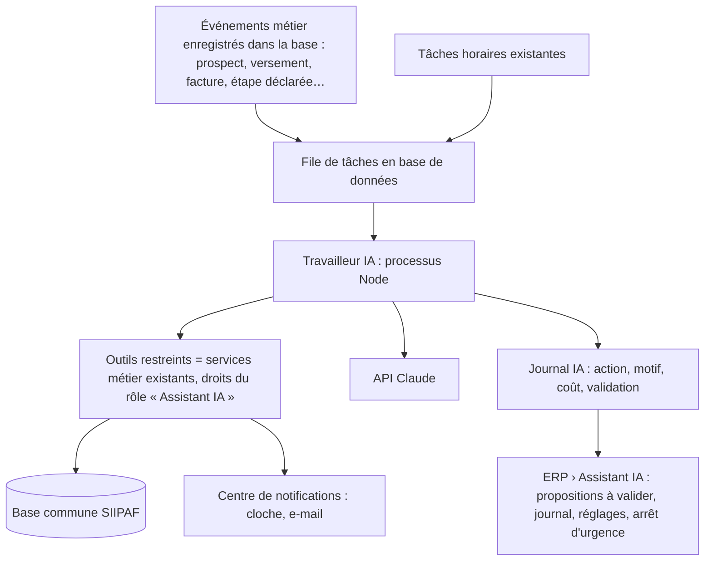

# SIIPAF — Étude de faisabilité de l'IA dans la plateforme Admin – ERP

**Date :** 24 octobre 2026
**Objet :** étude de faisabilité et amélioration de la proposition `docs/strategie-commercial-ia-siipaf.md` (rédigée avec ChatGPT), pour une mise en place effective et un fonctionnement optimal.
**Calendrier voulu par le client :** à la suite de tous les modules de l'ERP (Chantiers lots 4 à 6, puis Achats & stocks).
**Statut :** étude ; aucune fonctionnalité d'IA n'est développée à ce stade.

---

## 1. Verdict

La proposition est **sérieuse, prudente et réalisable dans son principe** : elle place l'IA au service des données existantes, garde les règles dans le serveur, prévoit des validations humaines et mesure la rentabilité. Elle reste toutefois **générique** sur quatre points que cette étude corrige :

1. **Elle ignore les contraintes réelles d'hébergement** : SIIPAF tourne sur un hébergement mutualisé cPanel (LWS). Pas de Redis ni de processus permanent garantis, pas de connexion vocale en continu : la file BullMQ/Redis et la voix 24 h/24 proposées ne peuvent pas y tourner.
2. **Elle sous-estime ce qui existe déjà** : centre de notifications, tâches horaires, droits par rôle, coûts réels et alertes de budget des chantiers, impayés transmis au Juridique, lieux et axe analytique. Plusieurs « agents » sont en réalité des **règles déterministes** déjà en place ou faciles à ajouter, sans IA.
3. **Elle range au même niveau des missions de difficulté et de risque très différents** : un rapport quotidien interne n'a rien à voir avec un démarchage sur LinkedIn ou un standard vocal.
4. **Elle ne s'appuie pas sur le cadre ivoirien** des données personnelles : loi n° 2013-450 du 19 juin 2013 et déclaration ou autorisation auprès de l'ARTCI, à faire confirmer par le juriste avant toute collecte de prospects ou tout enregistrement de conversation.

**Recommandation :** construire l'IA comme un **module « Assistant IA » de l'ERP**, en trois vagues, en commençant par ce qui crée de la valeur **sans compte externe ni risque juridique** : synthèses, contrôles, extraction de factures, assistant sur le site. Les canaux externes viennent ensuite (WhatsApp, publicité), la voix en dernier.

## 2. Ce que SIIPAF a déjà (fondations réutilisables)

| Brique existante | Où | Usage par l'IA |
|---|---|---|
| Comptes, rôles et droits (`PERMISSION_CATALOG`) | serveur, dashboard, ERP | Un **compte technique « Assistant IA »** avec un rôle dédié : l'IA n'a que les droits de ce rôle, comme un employé. |
| Centre de notifications commun (`notify`, cloche, e-mail) | `services/notifications.js` | Canal des propositions, alertes et demandes de validation. |
| Tâches horaires (`tick` de chaque module) | `app.js` | Point d'accroche des contrôles et rapports périodiques. |
| Pipeline, activités, rendez-vous, portefeuille | Service commercial | Qualification et relances enregistrées dans le CRM existant. |
| Échéanciers, versements, appels de fonds VEFA, impayés | Ventes, Juridique | Rappels d'échéances calculés (pas « devinés » par l'IA). |
| Coûts réels, budgets, alertes de budget, retards et livraisons promises | Chantiers (lots 1 à 3) | Contrôle budgétaire (agent A7) en grande partie déjà réalisé par règles. |
| Lieux et axe analytique programme / chantier / lieu | Comptabilité | Analyse des dépenses par centre de coût (siège, bureaux, dépôts). |
| Factures d'achat en brouillon, validation comptable | Comptabilité | Cible de l'extraction automatique de factures (PDF, photo). |
| Catalogue public (projets, lots, prix, conditions) | API publique du site | Source unique des réponses de l'assistant du site. |

**À construire (manquant pour l'IA)** :
- **journal des événements** : la brique 6.2 de l'analyse des liaisons, jamais faite ;
- **registre des consentements de contact** ;
- **origine et campagne des prospects** ;
- **journal des actions et des coûts de l'IA** ;
- **file de tâches durable** compatible avec l'hébergement.

## 3. Faisabilité mission par mission

Légende : 🟢 faisable sur l'infrastructure actuelle · 🟡 faisable avec un service ou un accès externe à obtenir · 🔴 à déconseiller ou à repenser.

| Mission (proposition) | Faisabilité | Ce qui change par rapport à la proposition |
|---|---|---|
| **A10 Rapport quotidien et brief de Direction** | 🟢 | Chiffres calculés par des requêtes (Vue Direction existante) ; l'IA ne rédige que la synthèse, une fois par jour et par rôle. **Premier livrable recommandé.** |
| **A7 Alertes de budget** | 🟢 (déjà en partie fait) | Seuil et dépassement déjà en place sur les chantiers. À ajouter avec Achats & stocks : engagements (commandes) et coût final prévisionnel. L'IA explique l'écart ; elle ne le calcule pas. |
| **A8 Dépenses et marge** | 🟢 | Doublons de factures, prix inhabituels, fractionnement d'achats : **règles SQL déterministes**. L'IA rédige le dossier d'anomalie et propose une action ; elle n'accuse personne. |
| **A9 Opérations entre modules** | 🟢 | Point fort à exploiter : **lecture des factures fournisseurs (PDF ou photo) → facture d'achat en brouillon** (fournisseur, montants, TVA, affectation proposée). Le comptable valide. Même principe pour les contrats et les pièces des clients. |
| **A2 Conseiller sur le site** | 🟢 | Assistant sur siipaf.com qui répond **uniquement à partir du catalogue et d'une base de réponses validées**, qualifie le besoin et crée le prospect dans le pipeline avec le motif. Transfert vers un commercial (rappel, WhatsApp). |
| **A6 Suivi des échéances** | 🟢 par e-mail et espace client · 🟡 par WhatsApp | Rappels J−7 et J−1 calculés depuis l'échéancier : c'est une **règle, pas de l'IA**. L'IA aide seulement à rédiger un message personnalisé quand il y a une difficulté. WhatsApp exige des modèles approuvés par Meta ; le recouvrement de dettes est restreint par sa politique. |
| **A3 Relances de prospection** | 🟡 | Séquences limitées, arrêtées dès qu'un humain reprend la main ; consentement vérifié avant chaque envoi. E-mail d'abord, WhatsApp quand le compte Business est validé. |
| **A4 Marketing** | 🟡 | L'IA prépare textes et variantes à partir de faits validés ; la publication et le budget publicitaire restent humains. Récupération des prospects Facebook / Google Ads par leurs interfaces officielles (comptes publicitaires de SIIPAF requis). |
| **A1 Recherche de prospects sur le web** | 🔴 en l'état | Collecter des profils (LinkedIn, groupes Facebook) pour les contacter est contraire aux conditions de ces plateformes et risqué au regard de la loi ivoirienne sur les données personnelles. **À recentrer** sur la veille (partenaires, entreprises, événements, appels d'offres publics) et sur les formulaires officiels des campagnes. |
| **A5 Standard vocal 24 h/24** | 🟡 puis 🔴 sur l'hébergement actuel | Exige un opérateur SIP ivoirien (Orange, MTN, Moov ou un agrégateur), un serveur toujours actif (VPS) et une évaluation des accents et du bruit. **À faire en dernier**, après preuve de la valeur des canaux écrits. Alternative immédiate : rappel demandé depuis le site ou WhatsApp. |

## 4. Architecture adaptée à SIIPAF

Choix techniques, adaptés et tranchés :
1. **Pas de Redis** : une **table `ai_jobs` en base** (statut, essais, clé anti-doublon, échéance) suffit aux volumes de SIIPAF et fonctionne sur l'hébergement actuel. Un **travailleur Node** la vide : d'abord dans le serveur actuel, au rythme des tâches horaires ; plus tard sur un petit VPS si la voix ou le temps réel deviennent nécessaires.
2. **Les outils de l'IA sont les services existants** (`services/*.js`), appelés avec le compte technique : mêmes contrôles, mêmes droits, mêmes notifications. Aucune requête directe en base écrite par l'IA.
3. **Tout ce qui est calcul reste du code** : prix, soldes, échéances, budgets, coût horaire, retards. L'IA comprend, rédige, classe, extrait et explique.
4. **Journal des événements** : une table `events` écrite dans la même transaction que l'action métier ; c'est la brique 6.2 de l'analyse des liaisons. Elle sert aussi l'historique de chaque fiche, demandé depuis longtemps.
5. **Validation humaine par défaut** : chaque proposition est une ligne « à valider » dans l'ERP et une notification ; l'autonomie s'élargit mission par mission, après mesure.
6. **Arrêt d'urgence** : un réglage coupe tous les envois et toutes les actions de l'IA ; les tâches restent en file.

### Choix du modèle d'IA

- **Fournisseur :** l'API Claude d'Anthropic. Elle dispose de SDK officiels pour Node (`@anthropic-ai/sdk`, le langage du serveur SIIPAF), de l'appel d'outils (tool use), de la lecture de PDF et d'images, de la mise en cache du contexte et du traitement par lots asynchrone, moins cher pour les tâches non urgentes.
- **Modèle par défaut :** Claude Opus 5.5 (`claude-opus-5-5`) pour le raisonnement : analyses, explications budgétaires, brief de Direction.
- **Modèles moins coûteux à mesurer ensuite :** Claude Sonnet 5.5 (`claude-sonnet-5-5`) ou Claude Haiku 5.5 (`claude-haiku-5-5`) pour les tâches à fort volume (classement, extraction, réponses du site). Une couche d'abstraction permet de changer de modèle par mission sans toucher au métier.
- **Coûts :**
  - le catalogue et les réponses validées sont mis en cache ;
  - les rapports de nuit et les analyses non urgentes passent par le traitement par lots ;
  - chaque appel est journalisé avec son coût (affiché dans l'ERP, plafond par jour et par mission) ;
  - aucun chiffrage n'est donné ici : les tarifs se relèvent au lancement.
- **Clé d'API :** dans `server/.env` uniquement. Seules les données nécessaires à chaque tâche sont envoyées, sans pièces d'identité ni données salariales.

## 5. Gouvernance, données et sécurité

- **Cadre légal ivoirien** : faire valider par le juriste la déclaration ou l'autorisation ARTCI pour les traitements nouveaux (prospects issus de campagnes, conversations, enregistrements vocaux), l'information des personnes et la durée de conservation.
- **Consentement** : registre par personne et par canal (e-mail, WhatsApp, appel) avec date et preuve ; une désinscription arrête tout, immédiatement et pour toutes les missions.
- **Cloisonnement** : l'assistant de l'espace client ne voit que le dossier du client connecté ; l'assistant du site ne voit que le catalogue public ; la RH et la paie restent hors de portée du commercial IA.
- **Injection de consignes** : les pages web, e-mails et documents lus par l'IA sont des données, jamais des ordres. Elle ne peut pas modifier ses propres droits.
- **Transparence** : l'IA se présente comme assistant ; elle dit « je ne sais pas » et transfère à un humain.
- **Décisions réservées aux humains** : remise, modification d'échéancier, pénalité, paiement, écriture validée, acte juridique, décision RH.

## 6. Mesure de la valeur

Je reprends les indicateurs de la proposition (coût par prospect qualifié, conversion par cohorte, encaissement à l'échéance, ROI incrémental) avec deux ajouts :

- **Qualité** : un jeu de questions et de réponses de référence, validé par le commercial et le juriste, rejoué avant chaque changement de modèle ou de consigne ; toute erreur sur un prix ou une condition bloque la mise en ligne.
- **Temps gagné** : factures saisies automatiquement et validées sans correction, relances préparées, rapports non rédigés à la main. C'est le gain le plus rapide et le plus mesurable pour SIIPAF.

## 7. Feuille de route, à la suite des modules de l'ERP

**Pendant les modules restants** (aucun coût d'IA, sans autre décision à prendre) — poser les fondations dans le code que j'écris de toute façon :
- journal des événements (`events`) et historique sur chaque fiche ;
- origine, campagne et consentement de contact sur les prospects ;
- engagements (commandes) dans Achats & stocks, pour le coût final prévisionnel des chantiers.

| Vague | Contenu | Prérequis | Critère pour passer à la suite |
|---|---|---|---|
| **0 — Cadrage** (1 à 2 semaines) | Rôle « Assistant IA », table `ai_jobs`, journal et coûts, page ERP › Assistant IA (propositions, journal, réglages, arrêt d'urgence), base de réponses validées. | Clé d'API, validation juridique ARTCI, liste des questions fréquentes. | Journal et arrêt d'urgence opérationnels. |
| **1 — Interne** | Brief quotidien par rôle, explication des alertes budgétaires et des retards, anomalies de dépenses, **lecture des factures → brouillon**. | Vague 0. | Moins de saisie manuelle mesurée ; aucune écriture validée sans contrôle humain. |
| **2 — Site et CRM** | Assistant sur siipaf.com (catalogue, qualification, rendez-vous, création du prospect), préparation des visites, réactivation des anciens prospects par e-mail. | Base de réponses validée, consentement. | Exactitude des réponses ≥ seuil fixé, transfert humain fonctionnel. |
| **3 — Canaux** | WhatsApp Business (modèles approuvés), récupération des prospects des campagnes Facebook et Google Ads, rappels d'échéances sur les canaux admis. | Comptes Business validés par Meta et Google. | Coût par prospect qualifié suivi, aucun envoi en double. |
| **4 — Voix** | Standard vocal hors horaires, rappels demandés. | Opérateur SIP ivoirien, VPS, évaluation des accents. | Rendez-vous confirmés sans conflit, satisfaction mesurée. |

**Première version conseillée** (plus prudente que celle de la proposition, qui commence par le site) : **brief de Direction quotidien + lecture des factures fournisseurs + explication des alertes de budget**. Elle n'exige aucun compte externe, ne parle à aucun client et rend un service mesurable dès la première semaine. L'assistant du site vient juste après, une fois la base de réponses validée.

## 8. Ce que le client doit préparer

1. Accord sur la vague 0 et sur le budget d'IA mensuel plafonné.
2. Compte et clé d'API Anthropic au nom de SIIPAF (à placer dans `server/.env`, jamais dans la discussion).
3. Validation par le juriste des traitements de données (ARTCI) et des mentions d'information.
4. Les questions fréquentes des acquéreurs et leurs réponses validées (commercial et juridique).
5. Pour la vague 3 : compte WhatsApp Business vérifié, comptes publicitaires Meta et Google au nom de SIIPAF.
6. Pour la vague 4 : choix d'un opérateur téléphonique et d'un hébergement VPS.

---

*Sources : proposition `docs/strategie-commercial-ia-siipaf.md` (et les sources officielles qu'elle cite) ; code du projet au 24/10/2026 ; documentation de l'API Claude (modèles et fonctions disponibles) consultée le 24/10/2026. Le cadre légal ivoirien cité est à confirmer par le juriste de SIIPAF.*
