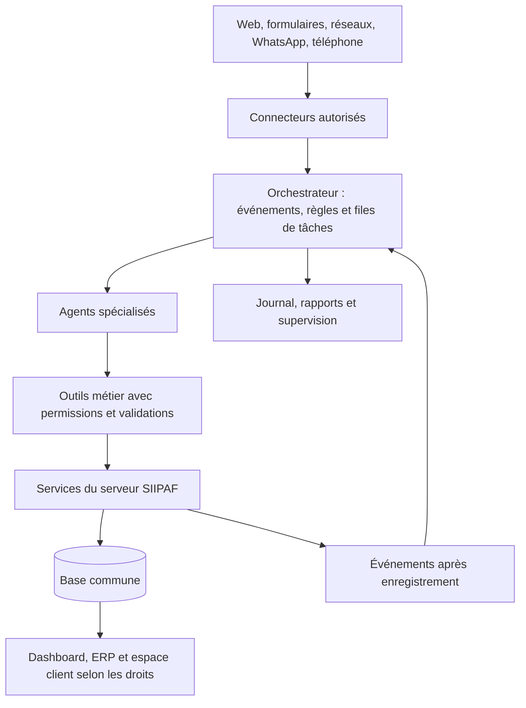

# SIIPAF — Stratégie d’intégration de l’intelligence artificielle

## Commercial IA, automatisation de l’ERP et pilotage de la rentabilité

**Date :** 24 octobre 2026  
**Nature :** document d’idées et de cadrage stratégique.  
**Périmètre :** acquisition de prospects, conversion, relation client, encaissements, maîtrise des coûts et coordination des services.  
**Statut :** propositions à étudier ; la rédaction de ce document n’implémente aucune fonctionnalité.

---

## 1. Recommandation principale

Créer un **service commercial et opérationnel assisté par IA**, intégré aux données de SIIPAF, avec des missions distinctes et un pilotage commun.

Ce dispositif doit poursuivre quatre résultats :

1. **Acquérir des clients rentables** : repérer des opportunités, qualifier les besoins et obtenir des rendez-vous utiles.
2. **Améliorer la conversion** : informer correctement, répondre rapidement et suivre chaque opportunité jusqu’à la décision.
3. **Sécuriser les encaissements** : rappeler les échéances, suivre les promesses de paiement et orienter les difficultés vers le bon interlocuteur.
4. **Préserver la marge** : détecter les dérives de dépenses, les engagements excessifs et les dysfonctionnements entre services.

Chaque agent reçoit une mission, des outils autorisés, un budget de fonctionnement, un responsable humain et des indicateurs. Plusieurs missions peuvent être assurées par le même moteur IA : il n’est pas nécessaire de payer dix infrastructures indépendantes.

**Le critère de réussite est la valeur économique créée après les coûts de publicité, de communication, d’IA et de traitement humain.** Le volume de messages envoyés reste un indicateur d’activité.

## 2. Ce que le projet actuel permet de préparer

Une lecture ciblée du code montre déjà des points d’appui :

| Socle existant | Utilité pour les futurs agents |
|---|---|
| Prospects, portefeuille, pipeline et activités commerciales | Enregistrer les opportunités et leur historique sans créer un CRM parallèle. |
| Projets, lots, prix et conditions d’acquisition | Présenter des offres issues du catalogue réel. |
| Rendez-vous et responsables commerciaux | Attribuer les demandes et préparer les visites ou appels. |
| Dossiers de vente, échéanciers et versements | Calculer les rappels à partir des engagements du dossier et des paiements enregistrés. |
| Comptabilité analytique et marge par programme | Alimenter les analyses financières, selon la qualité des écritures et affectations. |
| Chantiers et budgets par poste | Comparer les enveloppes aux dépenses lorsque leur rapprochement est disponible. |
| Demandes internes et circuits de validation | Faire suivre une proposition d’achat au bon responsable. |
| SAV, juridique, contrats, parc et RH | Orienter les demandes et anticiper les échéances opérationnelles. |
| Centre de notifications commun de l’ERP | Distribuer les alertes et demandes d’action. |
| Serveur partagé entre dashboard, ERP et espace client | Conserver une source de données commune. |

**À construire dans cette proposition :** connecteurs des canaux, moteur d’exécution des agents, supervision, mesure des résultats et contrôles d’accès propres à l’IA.

La disponibilité complète d’un circuit achats–commandes–réceptions–stocks et d’un contrôle budgétaire consolidé projet/programme/siège reste à confirmer lors du cadrage. Une ligne de budget existante ne suffit pas à produire une prévision fiable du coût final.

Cette analyse porte sur le code local consulté ; elle ne certifie pas le paramétrage ni les données actuellement exploitées en production.

## 3. Organisation proposée : dix missions d’agents

| Agent | Mission | Résultat attendu | Responsable métier |
|---|---|---|---|
| A1 — Recherche d’opportunités | Découvrir et documenter des pistes commerciales sur les sources accessibles. | Opportunités pertinentes et traçables. | Direction commerciale |
| A2 — Conseiller commercial | Qualifier le besoin et expliquer les offres et conditions réelles. | Prospects qualifiés et propositions adaptées. | Responsable commercial |
| A3 — Suivi de prospection | Organiser les prises de contact et relances autorisées. | Rendez-vous, visites et progression des dossiers. | Responsable commercial |
| A4 — Marketing et communication | Préparer les campagnes, contenus et analyses d’acquisition. | Demandes entrantes au coût maîtrisé. | Marketing |
| A5 — Accueil vocal et rendez-vous | Répondre au téléphone 24 h/24 et planifier les échanges. | Moins de demandes perdues et de rendez-vous manqués. | Relation client |
| A6 — Suivi des échéances | Préparer les rappels et suivre les réponses des souscripteurs. | Échéances mieux suivies et difficultés prises en charge. | Comptabilité / commercial |
| A7 — Contrôle budgétaire | Surveiller les enveloppes et les coûts prévisionnels. | Alertes anticipées par chantier, programme et siège. | Direction financière |
| A8 — Dépenses et marge | Analyser les achats, anomalies et possibilités d’économie. | Réduction des pertes et décisions mieux documentées. | Finance / achats |
| A9 — Assistant des opérations ERP | Préparer et acheminer les actions entre modules. | Moins de ressaisies et de tâches oubliées. | Responsables de services |
| A10 — Orchestrateur et reporting | Coordonner les missions, arbitrer les priorités et produire les bilans. | Fonctionnement cohérent et résultats visibles dans les interfaces. | Direction générale |

## 4. A1 — Rechercher des prospects sur le web

### Pourquoi

Développer plusieurs sources d’acquisition et repérer les partenaires capables d’apporter des clients : entreprises, associations professionnelles, apporteurs d’affaires et réseaux intéressés par les offres de SIIPAF.

### Comment

L’agent reçoit une fiche de recherche : offre à promouvoir, zone du bien, capacité de paiement recherchée, calendrier et profil de besoin. Il distingue :

- **Un signal** : contenu pouvant indiquer un intérêt, à vérifier.
- **Une opportunité documentée** : personne ou organisation pertinente dont la source est identifiable.
- **Un prospect qualifié** : contact ayant confirmé un besoin et accepté la suite de l’échange.

Une annonce publiée par un vendeur concurrent peut servir à la veille ; elle ne constitue pas automatiquement un prospect acheteur.

### Sources et chemins d’intégration

| Source | Usage proposé | Mise en œuvre envisagée |
|---|---|---|
| Google / recherche web | Veille sur les besoins exprimés publiquement, organisations et partenaires. | Fournisseur de recherche autorisé ; liens et dates conservés ; vérification avant contact. |
| Google Ads | Capter les recherches d’achat avec une offre précise. | Campagne → formulaire → CRM. Google documente une réception des formulaires par webhook. [Source Google](https://developers.google.com/google-ads/webhook/docs/overview). |
| LinkedIn | Partenariats, entreprises, événements et formulaires de génération de prospects. | Lead Sync si l’accès est obtenu ; son API est soumise à une procédure d’admission et à une autorisation. [Documentation LinkedIn](https://learn.microsoft.com/en-us/linkedin/marketing/lead-sync/leadsync-overview?view=li-lms-2026-07). |
| Facebook / Instagram | Campagnes immobilières, demandes entrantes et formulaires. | Étudier la récupération des leads via les interfaces officielles et les accès du compte SIIPAF. Meta publie un guide de raccordement. [Ressource officielle Meta](https://github.com/facebookincubator/catalogue-of-api-solutions/blob/main/solutions/leads/leads-retrieval-set-up-checker.md). |
| WhatsApp | Accueillir les demandes et poursuivre les échanges autorisés. | Numéro professionnel, liens depuis les campagnes et enregistrement des préférences de communication. |
| Sites d’annonces | Publier les biens, recevoir les demandes et suivre leur performance. | Connecteur, export ou partenariat selon chaque portail ; inventaire des accès avant développement. |
| Site SIIPAF | Transformer les visites en demandes identifiables. | Assistant, formulaires, demandes de rappel et pages propres à chaque campagne. |
| Parrainage et partenaires | Acquérir des clients recommandés et suivre les apports. | Lien ou code d’origine, règles de rémunération validées et rattachement au dossier. |

**Principe de faisabilité :** couvrir progressivement les sources utiles. Un accès illimité à tous les profils, messages privés et groupes du web n’est pas un prérequis réalisable à promettre. Chaque canal doit avoir une méthode d’accès documentée.

### Données à conserver

Source et URL, date, besoin déclaré, coordonnées fournies, fiabilité du signal, origine de campagne, autorisation de contact, responsable et prochaine action. La détection d’un profil ne vaut pas autorisation de le contacter sur tous les canaux.

## 5. A2 — Qualifier et conseiller comme un commercial SIIPAF

### Pourquoi

Concentrer le temps des commerciaux sur les dossiers compatibles avec les offres, tout en apportant une réponse utile aux autres visiteurs.

### Comment

L’agent pose quelques questions au fil de la conversation :

1. Recherchez-vous un terrain, un logement, un investissement ou un bien pour votre usage ?
2. Quelle localisation vous intéresse ?
3. Quel budget envisagez-vous et quel apport pouvez-vous mobiliser ?
4. Quel mode de financement souhaitez-vous étudier ?
5. À quel horizon souhaitez-vous acquérir ?
6. Préférez-vous une visite, un appel ou une visioconférence ?

Il consulte ensuite le catalogue et propose au maximum quelques options pertinentes, avec prix, disponibilité, acompte, durée, pièces et état des documents réellement renseignés.

**À faire :** une base de connaissances validée par le commercial et le juridique, avec auteur, date, version et périmètre public/interne. Les prix, lots et échéances doivent être relus dans les données métier au moment de répondre.

L’agent explique les étapes et les conditions. Il ne promet pas une disponibilité, un financement, une date de livraison ou un document juridique que les données ne permettent pas de confirmer.

### Priorité commerciale

Proposition initiale : classer selon la compatibilité avec l’offre, le calendrier d’achat, les réponses et la demande de rendez-vous. Afficher les motifs et permettre au commercial de corriger le classement.

Les critères restent liés au besoin exprimé et à la faisabilité de l’acquisition. Exclure les inférences sur la religion, l’origine ou d’autres caractéristiques personnelles sans rapport avec le dossier.

**Livrable :** une fiche synthétique, les offres proposées, les objections, le prochain engagement et le commercial affecté.

## 6. A3 — Automatiser la prospection et les relances

### Pourquoi

Assurer la continuité du suivi et éviter les demandes oubliées entre la première prise de contact et la visite.

### Comment

Créer des séquences selon la situation réelle du prospect. Exemple indicatif, à adapter aux préférences et horaires du contact :

| Moment | Action proposée | Condition |
|---|---|---|
| Nouvelle demande | Accusé de réception et première question utile. | Canal et autorisation adaptés. |
| Après qualification | Envoi d’une sélection et proposition de rendez-vous. | Offres vérifiées. |
| J+2 sans réponse | Relance courte centrée sur le besoin. | Aucun refus ni échange humain en cours. |
| Avant le rendez-vous | Confirmation, accès au lieu et possibilité de déplacer. | Rendez-vous toujours actif. |
| Après la visite | Recueil des objections et prochaine étape. | Compte rendu disponible. |
| Fin de séquence | Demander s’il faut poursuivre ou suspendre. | Plafond de sollicitations atteint. |

La réponse du prospect interrompt la séquence prévue pour déclencher une action adaptée. Un refus, une désinscription, un litige ou une reprise par un commercial suspend les relances concernées.

Sur WhatsApp, la politique exige l’autorisation du destinataire ; les prises de contact et messages hors fenêtre de service de 24 heures doivent utiliser les modèles approuvés applicables. Prévoir une sortie simple et un relais humain. [Politique WhatsApp Business](https://whatsappbusiness.com/policy/).

### Passer du prospect au client

L’IA prépare les informations et facilite le rendez-vous. La conversion doit suivre les règles métier du dossier de vente et les validations SIIPAF : une réponse positive ou un score élevé ne suffit pas à créer une vente définitive.

**À faire :** règles de cadence globales, contrôle des préférences juste avant chaque envoi, journal des communications et arrêt central des campagnes.

## 7. A4 — Marketing et communication orientés acquisition

### Pourquoi

Créer une demande régulière et identifier les campagnes qui produisent effectivement des dossiers de qualité.

### Segments à explorer

- **Projet de résidence principale** : localisation, usages, visite, financement et étapes d’acquisition.
- **Acquéreurs à distance** : vérification des pièces, suivi du chantier, visioconférence et interlocuteur identifiable.
- **Investisseurs** : coût complet, hypothèses documentées et risques ; aucune rentabilité locative garantie sans fondement.
- **Entreprises et organisations** : offres collectives, partenariats et rendez-vous de présentation.
- **Clients satisfaits** : recommandation et parrainage, selon un programme formalisé.

### Actions proposées

1. Construire un calendrier éditorial : présentation de programme, point chantier publié, explication d’une condition d’acquisition, visite et témoignage autorisé.
2. Produire textes et variantes à partir de faits et visuels approuvés.
3. Associer à chaque campagne une page, une offre, un appel à l’action et une source mesurable.
4. Préparer les publications pour validation, puis les programmer via un outil ou connecteur autorisé.
5. Comparer les résultats par segment, message et offre sur des périodes comparables.
6. Proposer une réallocation du budget lorsque le coût d’acquisition ou la qualité des demandes se dégrade.

Les modifications de budget publicitaire restent dans une enveloppe et des règles approuvées. L’IA ne doit pas augmenter les dépenses pour atteindre un objectif de volume.

**Ton recommandé :** professionnel, clair, rassurant et précis. Utiliser la preuve disponible — suivi réel, documents, conditions explicites — et éviter les fausses urgences ou les promesses de gain.

## 8. A5 — Accueil téléphonique 24 h/24 et rendez-vous

### Pourquoi

Prendre en charge les appels hors horaires et transmettre au commercial une demande déjà comprise.

### Parcours proposé

1. L’appelant est accueilli par un assistant vocal clairement identifié comme IA.
2. L’agent comprend le motif : offre, visite, dossier, paiement, document ou SAV.
3. Il répond aux questions publiques depuis les sources validées.
4. Pour une information personnelle, il demande une authentification adaptée ; le numéro appelant seul ne prouve pas l’identité.
5. Il consulte les créneaux et propose un rendez-vous.
6. Il confirme seulement après l’enregistrement réussi et envoie un récapitulatif sur le canal convenu.
7. Il transmet le contexte au collaborateur ou crée une demande de rappel si nécessaire.

### Mise en œuvre envisagée

Un opérateur téléphonique/SIP relie le numéro professionnel au moteur vocal. La documentation OpenAI décrit l’intégration téléphonique et le transfert d’un appel actif ; ses conversations temps réel peuvent appeler des fonctions métier pour consulter un agenda ou créer une demande. [Téléphonie et SIP](https://developers.openai.com/api/docs/guides/voice-sip), [actions dans une conversation temps réel](https://developers.openai.com/api/docs/guides/realtime-conversations).

La couverture des numéros ivoiriens, le routage, le coût des minutes et la qualité audio doivent être confirmés auprès de l’opérateur retenu. Prévoir une évaluation avec les façons de parler des utilisateurs, du bruit et une mauvaise connexion.

**À faire :** une source d’agenda principale, des règles de disponibilité, prévention des doubles réservations, déplacement/annulation et fuseau du contact. Google Agenda peut être un agenda raccordé ; le choix de la source principale doit être explicite.

Pour les appels sortants, commencer par les rappels expressément demandés. La permanence 24 h/24 suppose aussi un dispositif de repli : message, demande de rappel et notification de panne.

## 9. A6 — Suivi des échéanciers et des souscripteurs

### Pourquoi

Réduire les oublis, suivre les paiements attendus et détecter tôt les difficultés.

### Comment

Utiliser **l’échéancier du dossier et les versements enregistrés**, avec les particularités des appels de fonds VEFA. Les conditions actuelles du catalogue ne doivent pas remplacer les conditions figées d’un dossier existant.

Exemple de politique à valider :

| Étape | Action proposée |
|---|---|
| J−7 | Rappel de la prochaine échéance et lien vers l’espace client. |
| J−1 | Notification courte si le paiement reste attendu. |
| À réception d’un paiement | Arrêt des rappels couverts, contrôle de rapprochement et confirmation appropriée. |
| Retard constaté | Vérification comptable, puis action adaptée selon le canal admissible et le niveau de retard. |
| Difficulté ou contestation | Transmission au commercial et à la comptabilité ; suspension de la séquence automatique. |
| Retard persistant | Application du circuit commercial/juridique approuvé. |

Un reçu transmis par le client déclenche une vérification, sans être traité automatiquement comme un paiement définitivement rapproché. En cas de paiement partiel, recalculer le reste avant chaque rappel.

Les rappels transactionnels de paiement figurent parmi les usages « utility » présentés par WhatsApp. La politique distingue toutefois ces usages du recouvrement de dettes, activité restreinte/prohibée par la plateforme. Faire confirmer le scénario et les modèles par le fournisseur ; prévoir l’espace client, l’e-mail, le SMS ou un traitement humain pour les démarches non admissibles. [Usages transactionnels](https://whatsappbusiness.com/products/conversation-categories/utility/), [politique de la plateforme](https://whatsappbusiness.com/policy/).

**L’agent peut proposer un suivi ; il ne modifie pas seul un échéancier, n’applique pas de pénalité et n’accorde pas de remise de dette.**

## 10. A7 — Alerter sur les budgets des projets, programmes et du siège

### Pourquoi

Intervenir avant qu’une commande ou un coût prévisionnel rende le dépassement inévitable.

### Données nécessaires

- Budget initial et révisions approuvées, par période et poste.
- Commandes ou engagements autorisés restant à facturer.
- Réceptions, factures, avoirs et charges enregistrées.
- Paiements, suivis séparément des coûts.
- Estimation du travail restant et avancement physique.
- Affectation explicite au chantier, programme ou centre de coût du siège.

Le regroupement « non affecté » ne doit pas devenir automatiquement « siège » : il peut contenir des écritures en attente d’imputation.

### Calculs proposés

```text
Exposition budgétaire = coûts constatés + engagements non encore constatés

Coût final prévisionnel = coûts constatés + estimation complète du reste à faire

Dépassement prévisionnel = coût final prévisionnel − budget révisé approuvé
```

Le reste à faire inclut les engagements qui restent à exécuter. Une commande, sa facture et son paiement ne constituent pas trois coûts à additionner. Les bases HT/TTC, les périodes et les règles d’affectation doivent être cohérentes et validées par la comptabilité.

### Alertes proposées

- Enveloppe consommée à 80 % et 95 % : seuils indicatifs à paramétrer selon l’avancement et le poste.
- Nouvelle demande faisant dépasser le budget disponible.
- Prévision du coût final supérieure au budget autorisé.
- Décalage inhabituel entre dépenses et avancement.
- Charge sans affectation ou sans pièce exploitable.

**Exemple fictif :** budget de 100 M FCFA, coûts constatés de 60 M, engagements restants de 30 M et travaux supplémentaires estimés à 20 M. Si ces 20 M sont bien distincts des engagements, la prévision atteint 110 M. L’alerte doit expliquer les 10 M d’écart et les postes concernés.

**Actions :** demander justification, préparer un arbitrage, proposer de différer un achat ou créer une demande de révision. Un blocage éventuel repose sur une règle approuvée dans l’ERP, avec circuit d’exception ; une simple suspicion de l’IA ne suffit pas.

## 11. A8 — Analyser les dépenses et améliorer la marge

### Pourquoi

Identifier les pertes évitables et comparer les économies possibles à leur effet sur la qualité, les délais et les ventes.

### Contrôles et analyses proposés

| Situation détectée | Action préparée par l’agent |
|---|---|
| Factures possiblement en double | Rapprocher fournisseur, numéro, date, montant et pièce ; demander vérification. |
| Prix inhabituel | Comparer des articles réellement équivalents : quantité, unité, qualité, transport et période. |
| Achat potentiellement fractionné | Signaler le regroupement de demandes proches pour contrôle humain. |
| Écart commande / réception / facture | Préparer un dossier d’écart avec les pièces disponibles. |
| Consommation de carburant ou matériaux inhabituelle | Comparer activité, engins, mouvements et avancement, si les données existent. |
| Frais récurrents peu utilisés | Proposer regroupement, renégociation ou résiliation à l’échéance. |
| Baisse de marge d’un programme | Distinguer évolution des prix, coûts, remises, frais d’acquisition et retards. |

L’IA documente une anomalie ; elle ne qualifie pas une personne de fraudeur. Une économie proposée ne devient une économie réalisée qu’après décision et mesure du résultat.

### Recommandations commerciales rentables

Prioriser les programmes avec stock réellement disponible, conditions fiables, capacité opérationnelle et contribution économique intéressante. Mesurer l’effet d’une remise sur la marge, pas seulement sur le nombre de ventes.

Une campagne peut être rentable commercialement mais accélérer une tension de trésorerie si les coûts immédiats précèdent largement les encaissements. Afficher les deux dimensions.

## 12. A9 — Automatiser les opérations entre modules ERP

### Pourquoi

Fluidifier les passages entre services et éviter qu’un dossier reste bloqué faute d’information ou d’affectation.

### Scénarios proposés

| Déclencheur | Suite préparée | Services concernés |
|---|---|---|
| Prospect qualifié | Affectation, activité et proposition de rendez-vous. | Commercial / dashboard |
| Visite réalisée | Synthèse des objections et tâche de suivi. | Commercial |
| Dossier ouvert selon les règles métier | Liste des pièces et tâches de préparation. | Commercial / juridique / comptabilité |
| Versement enregistré | Mise à jour du suivi et arrêt des rappels correspondants. | Comptabilité / commercial / espace client |
| Point chantier approuvé | Préparer l’information client et les actions prévues par les règles VEFA existantes. | Chantiers / commercial / comptabilité |
| Besoin de matériel | Vérifier les données de disponibilité, préparer une demande et la faire valider. | Chantiers / parc / achats |
| Réclamation client | Classer, prioriser et affecter un ticket avec le contexte du dossier. | SAV / chantiers / juridique |
| Échéance contractuelle | Préparer l’alerte, la pièce ou la demande de renouvellement. | Administration / finance / juridique |
| Document reçu | Extraire les champs, relever les pièces manquantes et préparer le classement. | Services autorisés |

L’extraction d’une facture ou d’un contrat produit un brouillon contrôlable. Les écritures comptables et effets contractuels suivent les validations du module concerné.

Les ressources humaines peuvent bénéficier d’une aide documentaire et d’orientation. Les données salariales et les décisions concernant les employés restent dans un périmètre d’accès distinct du commercial IA.

## 13. A10 — Orchestrer les agents et synchroniser les interfaces

### Pourquoi

Éviter les contradictions : relancer après un paiement, promouvoir un lot indisponible, doubler un rendez-vous ou lancer deux campagnes sur la même personne.

### Architecture proposée



### Responsabilités de l’orchestrateur

1. Recevoir un événement : demande, réponse, rendez-vous, paiement ou alerte.
2. Vérifier l’état actuel, les autorisations et les actions déjà exécutées.
3. Choisir une tâche et un agent compétent.
4. Exécuter uniquement les outils autorisés ou solliciter une validation.
5. Enregistrer l’issue, les erreurs et les coûts.
6. Programmer une suite utile ou clôturer le workflow.

Les agents ne doivent pas se transmettre indéfiniment la même tâche : limite d’étapes, durée maximale et plafond de coût par dossier.

### Synchronisation concrète

- Un même prospect, un même dossier et un même paiement portent les mêmes identifiants dans les interfaces.
- Les écritures passent par les services métier ; aucun agent ne modifie directement des tables à sa convenance.
- Les événements importants sont enregistrés avec la transaction métier, puis traités par une file durable.
- Chaque action possède une clé anti-doublon ; les reprises après erreur ne recréent pas un rendez-vous ou un envoi.
- Les interfaces reçoivent une actualisation adaptée ; partager la base ne suffit pas à rafraîchir un écran déjà ouvert.
- Un rapprochement périodique relève les écarts entre agendas, canaux externes et SIIPAF.

**Exemple :** un paiement valide est enregistré → événement de mise à jour → annulation des rappels concernés → actualisation des indicateurs → information du commercial. Juste avant un envoi déjà en file, le solde est relu.

## 14. Rapports journaliers et espace de supervision

### Rapport quotidien proposé

Disponible dans le dashboard et l’ERP, avec un périmètre selon les droits et des liens vers les dossiers sources :

1. **Acquisition** : pistes repérées, contacts uniques, prospects qualifiés, sources et coûts.
2. **Actions** : échanges, appels, relances, contenus publiés et actions en attente de validation.
3. **Conversion** : rendez-vous pris et tenus, visites, dossiers ouverts, ventes validées et motifs de perte.
4. **Encaissements** : sommes attendues, reçues, rapprochées, retards et promesses de paiement.
5. **Rentabilité** : coûts d’acquisition, anomalies de dépenses et risques budgétaires.
6. **Fiabilité** : canaux indisponibles, actions échouées, doublons évités et données manquantes.
7. **Plan du lendemain** : actions prioritaires, responsable et résultat attendu.

Les chiffres doivent être calculés par des requêtes métier. L’IA rédige l’explication et les recommandations en distinguant **faits**, **estimations** et **hypothèses**.

### Exemple de synthèse — chiffres entièrement fictifs

> 42 nouveaux contacts uniques, dont 18 qualifiés. Sept rendez-vous pris aujourd’hui ; cinq rendez-vous tenus aujourd’hui, issus de plusieurs journées d’acquisition. Trois demandes de dossier attendent une décision commerciale. Dépenses de campagne : 90 000 FCFA, soit 5 000 FCFA par prospect qualifié de la cohorte du jour. Deux écarts budgétaires nécessitent une vérification. Priorité demain : traiter les objections de financement et les demandes de visite sans créneau.

### Écran « Pilotage IA » envisagé

Vue d’ensemble, campagnes, opportunités, communications, rendez-vous, échéances, budgets, validations, journal et réglages. Chaque action présente son motif, sa source, son statut, son coût et son responsable.

Une commande naturelle peut compléter cet écran : « Prépare le suivi des visites sans réponse depuis sept jours ». L’assistant présente la sélection et l’action proposée avant toute exécution qui sort du mandat déjà approuvé.

## 15. Mesurer la rentabilité sans confondre les indicateurs

| Indicateur | Définition proposée |
|---|---|
| Coût par prospect qualifié | Coûts d’acquisition affectés ÷ prospects uniques qualifiés. |
| Coût d’acquisition client | Coûts complets d’acquisition et de conversion ÷ nouveaux clients selon une définition stable. |
| Taux de rendez-vous tenus | Rendez-vous effectivement tenus ÷ rendez-vous arrivés à échéance. |
| Conversion par cohorte | Clients issus d’un groupe de prospects ÷ prospects du même groupe, après un délai comparable. |
| Contribution par acquisition | Revenu reconnu selon les règles retenues, moins coûts et remises attribuables. |
| Encaissement à l’échéance | Montant réglé à temps ÷ montant devenu exigible sur la période. |
| Risque budgétaire | Dépassement prévisionnel documenté par poste et programme. |
| Coût opérationnel IA | Modèles, téléphonie, messages, connecteurs, infrastructure et supervision. |
| Qualité de service | Réponses exactes, transferts utiles, plaintes et corrections. |

### Calcul du retour sur investissement

```text
Gain net incrémental = marge supplémentaire attribuable
                    + économies réalisées et vérifiées
                    − coût complet supplémentaire du dispositif

ROI = gain net incrémental ÷ coût complet supplémentaire
```

**Exemple fictif, sans promesse de résultat :** 1 200 000 FCFA de marge supplémentaire, 200 000 FCFA d’économies vérifiées et 900 000 FCFA de coûts supplémentaires produiraient 500 000 FCFA de gain net, soit environ 56 % de ROI.

Un encaissement accéléré améliore la trésorerie ; il ne constitue pas à lui seul une marge supplémentaire. Une vente annoncée, un dossier ouvert, un revenu comptabilisé et un paiement reçu doivent rester des mesures distinctes.

Conserver source initiale, campagne de conversion et interventions humaines. Comparer à une période de référence et, lorsque possible, à un groupe comparable ; éviter d’attribuer à l’IA toutes les ventes survenues après son installation.

## 16. Gouvernance et autonomie progressive

| Niveau | Exemples d’actions |
|---|---|
| Exécution dans un mandat approuvé | Répondre sur le catalogue public, produire un rapport, préparer une fiche, envoyer un rappel autorisé, réserver un créneau confirmé par l’utilisateur. |
| Proposition avec validation | Campagne nouvelle, publication sensible, réallocation de budget, rapprochement incertain, demande d’achat, proposition de négociation. |
| Décision réservée aux responsables | Remise hors délégation, engagement contractuel, paiement bancaire, régularisation comptable, modification d’échéancier, décision juridique ou RH. |

### Règles d’exploitation

- Une identité technique distincte, avec permissions par outil et accès limité au besoin de la mission.
- Un périmètre propre à chaque client authentifié ; aucune consultation croisée de dossiers.
- Un registre des préférences et autorisations de contact, incluant les désinscriptions.
- Une limitation commune des sollicitations par personne, quel que soit l’agent.
- Un historique de qui a proposé, approuvé et exécuté chaque action.
- Des documents web traités comme des sources non fiables : leur contenu ne peut pas donner des ordres aux agents ni modifier leurs permissions.
- Des secrets conservés côté serveur ; seules les données nécessaires sont transmises aux fournisseurs.
- Une politique de conservation des conversations et un cadre d’information pour l’audio, définis avant exploitation selon les exigences applicables.
- Un arrêt d’urgence des envois et appels, avec conservation des tâches pour reprise contrôlée.

La supervision porte sur les engagements pris au nom de SIIPAF et la qualité de service. L’agent doit pouvoir dire qu’il ne sait pas et transmettre une demande.

## 17. Mise en œuvre technique envisagée

### Socle recommandé pour SIIPAF

1. **Conserver le serveur et les services métier existants** comme référence pour les accès et les règles.
2. Ajouter une couche d’outils restreints : consulter une offre, qualifier une fiche, créer une activité, proposer un créneau, préparer un rappel ou expliquer un indicateur.
3. Prévoir des processus de traitement en arrière-plan avec une file persistante, par exemple BullMQ/Redis ou un service équivalent, à comparer lors du choix technique.
4. Exécuter les calculs de prix, soldes et budgets dans du code déterministe ; utiliser l’IA pour comprendre, dialoguer, synthétiser et proposer.
5. Construire la connaissance documentaire à partir de contenus validés et filtrés par permissions ; la recherche documentaire augmentée peut être ajoutée si le volume le justifie.
6. Brancher progressivement les canaux : site, un canal de messagerie, un canal d’acquisition, puis téléphonie.
7. Ajouter événements, journal d’actions, suivi des coûts et supervision partagée.

### Hébergement

L’hébergement actuel peut conserver le rôle d’application métier. Pour les traitements continus et la voix, évaluer un service de workers ou un VPS supervisé, raccordé à l’API SIIPAF. La décision dépend des limites du contrat d’hébergement, des connexions persistantes, de la disponibilité attendue et du volume.

Un outil de workflow tel que n8n peut accélérer certains raccordements. Les validations critiques et les contrôles d’accès restent dans le serveur SIIPAF pour ne pas être dupliqués dans chaque automatisation.

### Données complémentaires à prévoir

Origine des opportunités, autorisations de contact, campagnes, conversations, états des séquences, résultats d’envoi, versions des contenus approuvés, coûts, propositions, validations et événements d’exécution. Leur schéma sera défini lors de l’implémentation.

## 18. Feuille de route proposée

**Horizon indicatif :** un pilote peut être organisé sur environ douze semaines, selon l’équipe, la disponibilité des données et les validations des fournisseurs. Les étapes suivantes restent conditionnées à leurs résultats.

| Étape | Contenu | Critère de passage |
|---|---|---|
| 0 — Cadrage | Définir les offres, responsabilités, données fiables, canaux accessibles et indicateurs de départ. | Catalogue validé, mandat et plafonds explicites. |
| 1 — Pilote commercial | Un programme, assistant du site, qualification, fiches et rapport journalier ; WhatsApp si les accès sont prêts. | Exactitude des réponses, respect des préférences et transfert humain fonctionnel. |
| 2 — Conversion | Séquences limitées, agenda, compte rendu de visite et traitement d’un canal d’acquisition. | Aucune action en double sur les scénarios retenus ; résultats commerciaux mesurables. |
| 3 — Échéances et voix | Suivi des rappels avec contrôle comptable, puis accueil vocal et repli. | Rappels cohérents après paiements partiels et rendez-vous confirmés sans conflit. |
| 4 — Finance | Un chantier pilote : budgets, engagements, factures, coût final et anomalies. | Totaux rapprochés avec la comptabilité et pistes d’audit accessibles. |
| 5 — Orchestration élargie | Nouveaux canaux et modules, selon les gains démontrés. | Coût maîtrisé, qualité stable et bénéfice attribuable. |

### Première version conseillée

**Un conseiller IA sur le site, un canal de conversation, une qualification dans le CRM, une prise de rendez-vous et un rapport quotidien.**

En parallèle, préparer la fiabilité des échéanciers et des affectations budgétaires. Le premier périmètre permet d’observer rapidement la valeur commerciale ; la préparation des données évite de bâtir ensuite des alertes financières trompeuses.

## 19. Budget de lancement et maîtrise des coûts

Le chiffrage doit séparer les frais de mise en place et les frais récurrents. Aucun prix fournisseur n’est garanti par ce document.

| Poste | Ce qu’il faut estimer |
|---|---|
| Cadrage et intégration | Interfaces, outils métier, connecteurs, contrôles et supervision. |
| IA texte | Conversations, taille du contexte, génération et fréquence des rapports. |
| Voix | Numéro, opérateur, minutes, moteur vocal et stockage éventuel. |
| Messagerie | Catégories de messages, destinataires, volume et frais de fournisseur. |
| Publicité | Budget propre à chaque campagne et offre. |
| Infrastructure | Files de tâches, workers, surveillance, sauvegarde et disponibilité. |
| Exploitation humaine | Validation, traitement des transferts et mise à jour des contenus. |

Prévoir trois scénarios de volume — pilote, régime courant et pic — à partir des demandes mensuelles observées. Fixer un plafond par campagne et par journée, et une alerte sur le coût par prospect qualifié.

Réduire les coûts en réutilisant les réponses publiques validées, en limitant le contexte envoyé au modèle et en réservant la voix aux échanges qui la justifient. Les notifications simples et calculs répétitifs n’ont pas besoin d’un appel IA systématique.

## 20. Conditions pour décider de poursuivre

Avant tout développement, réunir :

- Les programmes et offres prioritaires, avec leurs marges et capacités commerciales.
- La définition SIIPAF d’un prospect qualifié, d’un client acquis et d’une vente validée.
- Les questions fréquentes et les réponses validées.
- Les comptes professionnels, accès API et autorisations réellement disponibles.
- Les responsables des transferts et les horaires de rappel.
- La politique de suivi commercial et des échéances.
- Les référentiels budgétaires et règles d’affectation.
- Les volumes de départ, coûts actuels et plafonds du pilote.

À l’issue du pilote, décider agent par agent : étendre, corriger, maintenir ou arrêter. Une automatisation qui augmente le volume tout en dégradant la marge ou l’expérience client doit être révisée.

## 21. Idées complémentaires à fort intérêt

1. **Veille des objections commerciales** : classer les raisons de non-conversion et proposer des réponses ou adaptations d’offre à faire valider.
2. **Réactivation des anciens prospects** : identifier ceux dont le besoin correspond à une nouvelle offre, puis reprendre contact dans le cadre autorisé.
3. **Assistant de préparation de visite** : dossier court pour le commercial avec besoin, historique, offres et points à confirmer.
4. **Parrainage assisté** : proposer une recommandation après une étape de satisfaction confirmée, sans solliciter un client en litige.
5. **Détection des dossiers incomplets** : pièces manquantes et tâches affectées avant le rendez-vous juridique.
6. **Prévision des encaissements** : scénario prudent, central et favorable fondé sur les échéances, retards et promesses ; hypothèses affichées.
7. **Alerte de promesse commerciale incohérente** : relever un écart entre un message préparé et les disponibilités, documents ou délais approuvés.
8. **Brief de direction** : les décisions à prendre aujourd’hui, leur impact estimé et les pièces nécessaires.

---

## Conclusion

Pour SIIPAF, la démarche la plus utile consiste à relier **acquisition → qualification → rendez-vous → dossier → encaissements → marge**, puis à automatiser progressivement les passages entre services.

Commencer avec un programme et quelques parcours bien maîtrisés permet de mesurer la contribution de l’IA avant d’étendre les canaux et l’autonomie. La rentabilité dépendra de la qualité des offres, des données, du suivi humain et de la discipline budgétaire autant que du moteur IA choisi.

## Références et base de travail

Les propositions organisationnelles, seuils et exemples chiffrés sont des recommandations de cadrage. Les liens ci-dessous servent à vérifier les possibilités et conditions des canaux, à recontrôler au lancement.

### Sources officielles consultées

- [Google Ads — Lead Form Webhook](https://developers.google.com/google-ads/webhook/docs/overview).
- [LinkedIn — Lead Sync, aperçu et conditions d’accès](https://learn.microsoft.com/en-us/linkedin/marketing/lead-sync/leadsync-overview?view=li-lms-2026-07).
- [Meta — raccordement de récupération des leads](https://github.com/facebookincubator/catalogue-of-api-solutions/blob/main/solutions/leads/leads-retrieval-set-up-checker.md). La page détaillée Meta Developers n’a pas pu être récupérée lors de cette recherche ; les permissions exactes sont à confirmer au cadrage.
- [WhatsApp — Business Messaging Policy](https://whatsappbusiness.com/policy/).
- [WhatsApp — Utility messages](https://whatsappbusiness.com/products/conversation-categories/utility/).
- [OpenAI — Telephony and SIP](https://developers.openai.com/api/docs/guides/voice-sip).
- [OpenAI — Realtime conversations](https://developers.openai.com/api/docs/guides/realtime-conversations).

### Points d’appui locaux consultés

- `server/src/app.js` : modules, interfaces et tâches périodiques.
- `server/src/routes/erp/commercial.js` et `server/src/services/commercial.js` : pipeline, activités et dossiers.
- `server/src/services/schedule.js` : échéanciers et affectation des versements.
- `server/src/services/compta.js` : états et marge analytique par programme.
- `server/src/services/chantiers.js` : budgets et organisation des chantiers.
- `server/src/services/requests.js` : demandes et validations.
- `server/src/services/juridique.js` : suivi interne des échéances et impayés.
- `server/src/services/notifications.js` : notifications communes.
- `passation.md` et `docs/analyse-liaisons-inter-services.md` : contexte et liaisons métier, recoupés avec le code pour les éléments retenus.
